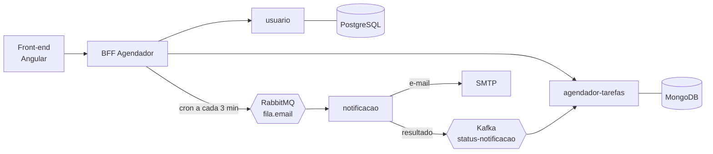

# 🚀 BFF Agendador

Backend for Frontend (BFF) do sistema **Agendador de Tarefas**, desenvolvido em **Java com Spring Boot**. Ele centraliza e intermedia a comunicação entre o front-end e os microsserviços da aplicação (usuário, tarefas e notificação), de forma que o cliente conheça apenas uma API. Também é ele quem dispara, de tempos em tempos, o fluxo de **lembretes por e-mail**, que usa **RabbitMQ** e **Kafka**.

> O front-end deste sistema está em: [agendador-tarefas-front](https://github.com/cardosogoc/agendador-tarefas-front)

---

## 🎥 Demonstração

[](https://www.youtube.com/watch?v=nDytDSMXsBw)

> Clique na imagem para assistir ao projeto rodando no YouTube.

---

## ✨ Destaques

- Comunicação declarativa com os microsserviços via **OpenFeign**
- Autenticação e controle de acesso com **Spring Security** e **JWT**
- **Tarefa agendada (cron)** que busca as tarefas da próxima hora e dispara o lembrete
- **Mensageria**: comando de envio de e-mail via **RabbitMQ** e resultado do envio via **Kafka**
- Retentativas e fila de mensagens com falha (**DLT**) no consumo do Kafka
- DTOs de entrada e saída separados
- Exceções personalizadas com resposta de erro padronizada
- Configuração de **CORS**
- Documentação interativa com **Swagger / OpenAPI**
- Ambiente completo com **Docker Compose**
- Análise de qualidade de código com **SonarQube**

---

## 🛠️ Tecnologias

- ☕ Java 25
- 🌱 Spring Boot 4
- 🔗 OpenFeign
- 🔐 Spring Security (JWT)
- 🐇 RabbitMQ (Spring AMQP)
- 📨 Apache Kafka (Spring Kafka)
- 📦 Gradle
- 🧩 Lombok
- 🐳 Docker e Docker Compose
- 📚 Swagger / OpenAPI
- 📊 SonarQube

### Visão geral do sistema

| Serviço | Responsabilidade | Principais tecnologias |
| --- | --- | --- |
| **Front-end** | Interface do usuário | Angular, TypeScript, Angular Material |
| **BFF Agendador** (este projeto) | Porta de entrada, JWT, cron dos lembretes | Spring Boot, OpenFeign, RabbitMQ (producer) |
| **usuario** | Cadastro, login, endereços e telefones | Spring Boot, PostgreSQL |
| **agendador-tarefas** | CRUD das tarefas e atualização de status | Spring Boot, MongoDB, Kafka (consumer) |
| **notificacao** | Envio do e-mail de lembrete | Spring Boot, SMTP, Thymeleaf, RabbitMQ (consumer), Kafka (producer) |

---

## 🏗️ Arquitetura



### Clientes Feign

| Cliente | Responsabilidade |
| --- | --- |
| `UsuarioClient` | Comunicação com o microsserviço de usuários |
| `TarefasClient` | Comunicação com o microsserviço de tarefas |
| `EmailClient` | Comunicação direta com o serviço de notificações (o envio automático dos lembretes agora passa pelo RabbitMQ) |

Os erros das chamadas Feign são tratados em `FeignError`.

---

## 📨 Mensageria e fluxo de notificação

O lembrete por e-mail usa dois brokers, cada um com o modelo que combina com o seu papel:

| | RabbitMQ | Kafka |
| --- | --- | --- |
| **Papel** | Fila de tarefas: entrega o **comando** "envie este e-mail" | Registro de eventos: publica o **resultado** do envio |
| **De → para** | BFF → `notificacao` | `notificacao` → `agendador-tarefas` |
| **Depois de lida** | A mensagem sai da fila | A mensagem permanece no tópico (retenção de 7 dias) |
| **Nomes** | Exchange `email.exchange`, chave `email.key`, fila `fila.email` | Tópico `status-notificacao`, grupo `grupo-agendador` |

### Passo a passo

1. **Cron do BFF** (`CronService`): a cada 3 minutos faz login, busca as tarefas que acontecem daqui a 1 hora (janela de 1h a 1h03) e marca cada uma como `AGUARDANDO`.
2. **Producer** (`EmailProducer`): publica a tarefa na exchange `email.exchange` do RabbitMQ.
3. **RabbitMQ**: roteia a mensagem para a `fila.email` e a guarda até o consumidor confirmar o recebimento.
4. **`notificacao`**: lê a mensagem, monta o e-mail com um template Thymeleaf e envia por SMTP.
5. **Resultado no Kafka**: o `notificacao` publica o status no tópico `status-notificacao`.
6. **`agendador-tarefas`**: o consumidor do grupo `grupo-agendador` atualiza o status da tarefa. Em caso de falha, tenta novamente até 3 vezes com espera crescente e, por fim, envia a mensagem para a DLT e grava a falha na coleção `mensageria-falha` do MongoDB.
7. **Front-end**: recarrega a lista de tempos em tempos e mostra o novo status.

### Status da tarefa

| Status | Significado |
| --- | --- |
| `PENDENTE` | Tarefa criada, ainda sem aviso enviado (ou envio que falhou por erro genérico ou de autenticação do SMTP) |
| `AGUARDANDO` | Lembrete publicado na fila, aguardando o envio |
| `NOTIFICADO` | E-mail enviado com sucesso |
| `CANCELADO` | E-mail inválido ou destinatário rejeitado |
| `CONCLUIDA` | Tarefa concluída |

---

## 📂 Estrutura do projeto

```text
src/main/java/com/javanauta/bffagendador
├── business
│   ├── dto
│   │   ├── in                 # Dados de entrada
│   │   └── out                # Dados de saída
│   ├── enums
│   └── service                # Inclui o CronService (lembretes)
├── controller
├── infraestructure
│   ├── client
│   │   ├── config             # FeignConfig e FeignError
│   │   ├── EmailClient
│   │   ├── TarefasClient
│   │   └── UsuarioClient
│   ├── configs
│   │   └── CorsConfig
│   ├── exceptions             # Exceções personalizadas e ErrorResponseDTO
│   ├── message
│   │   ├── config             # RabbitMqConfig (fila, exchange, binding e conversor JSON)
│   │   └── producer           # EmailProducer
│   └── security
│       └── SecurityConfig
└── BffAgendadorApplication
```

---

## 🔐 Segurança

A configuração de segurança fica em `infraestructure/security/SecurityConfig`. O acesso às operações protegidas é controlado por **token JWT**, enviado no header `Authorization`.

O cron do BFF usa uma conta de serviço para consultar as tarefas. As credenciais dela devem vir de variáveis de ambiente, e não do código.

## ⚠️ Tratamento de exceções

Exceções personalizadas representam as diferentes situações da aplicação:

- `BusinessException`
- `ConflictException`
- `ResourceNotFoundException`
- `UnauthorizedException`
- `IllegalArgumentException`

As respostas de erro seguem o padrão do `ErrorResponseDTO`, mantendo a API consistente para o cliente.

## 🌐 CORS

A configuração está em `infraestructure/configs/CorsConfig` e define quais origens podem fazer requisições ao BFF.

---

## ✅ Pré-requisitos

- JDK instalado
- Docker e Docker Compose

O projeto já inclui o Gradle Wrapper (`gradlew`), então não é necessário instalar o Gradle.

## ⚙️ Configuração

Tudo o que muda conforme o ambiente é configurado por **variáveis de ambiente**. Em um ambiente com Docker Compose, use o nome dos containers.

**BFF**

| Variável | Exemplo | Para que serve |
| --- | --- | --- |
| `USUARIO_URL` | `http://usuario:8080/usuario` | Serviço de usuários |
| `AGENDADOR_TAREFAS_URL` | `http://agendador-tarefas:8081/tarefas` | Serviço de tarefas |
| `NOTIFICACAO_URL` | `http://notificacao:8082/email` | Serviço de notificação |
| `SPRING_RABBITMQ_HOST` | `rabbitmq` | Host do RabbitMQ |
| `USUARIO_EMAIL` e `USUARIO_SENHA` | | Conta usada pelo cron para consultar as tarefas |
| `TZ` | `America/Sao_Paulo` | Fuso horário, essencial para a janela do cron dentro do Docker |

**notificacao**

| Variável | Exemplo | Para que serve |
| --- | --- | --- |
| `SPRING_RABBITMQ_HOST` | `rabbitmq` | Host do RabbitMQ |
| `SPRING_KAFKA_BOOTSTRAP_SERVERS` | `kafka:19092` | Endereço interno do Kafka |
| `MAIL_PASSWORD_NOTIFICACAO` | | Senha de app da conta SMTP |

**agendador-tarefas**

| Variável | Exemplo | Para que serve |
| --- | --- | --- |
| `SPRING_KAFKA_BOOTSTRAP_SERVERS` | `kafka:19092` | Endereço interno do Kafka |
| `SPRING_MONGODB_URI` | `mongodb://mongo:27017/db_agendador` | Banco de tarefas |

O frequência do cron é definida pela propriedade `cron.horario` (padrão: a cada 3 minutos).

> Evite deixar informações sensíveis diretamente no código; prefira variáveis de ambiente e mantenha o arquivo `.env` fora do repositório.

## ▶️ Como executar

### Com Gradle

```bash
./gradlew bootRun
```

No Windows:

```bash
gradlew.bat bootRun
```

Fora do Docker, os valores padrão apontam para `localhost`, então RabbitMQ e Kafka precisam estar acessíveis nas portas `5672` e `9092`.

### Com Docker Compose

Os serviços da aplicação e os brokers compartilham uma rede Docker externa, para que os containers se enxerguem pelo nome.

```bash
# 1. Rede compartilhada (uma única vez)
docker network create agendador-net

# 2. Brokers
docker compose -f docker-compose-rabbitmq.yml up -d
docker compose -f docker-compose-kafka.yml up -d

# 3. Aplicação (gere os jars antes com ./gradlew clean build -x test em cada serviço)
docker compose up --build -d
```

| Serviço | Endereço |
| --- | --- |
| BFF (Swagger) | http://localhost:8083/swagger-ui/index.html |
| Painel do RabbitMQ | http://localhost:15672 (`guest` / `guest`, apenas em desenvolvimento) |
| Kafka (fora do Docker) | `localhost:9092` |
| Kafka (dentro da rede Docker) | `kafka:19092` |

> O Kafka expõe dois endereços: `kafka:19092` para os containers da rede e `localhost:9092` para ferramentas e aplicações fora do Docker.

### Imagem do Docker Hub

Imagem publicada: [cardosogoc/bff-agendador](https://hub.docker.com/r/cardosogoc/bff-agendador)

---

## 🧪 Testando o fluxo de lembrete

1. Cadastre pelo Swagger a conta que o cron usa (`USUARIO_EMAIL` / `USUARIO_SENHA`) e um usuário seu, com um e-mail real.
2. Entre com o seu usuário e crie uma tarefa com `dataEvento` no formato `dd-MM-yyyy HH:mm:ss`, igual a **próximo disparo do cron + 1 hora + 1 minuto**. O cron roda nos minutos 0, 3, 6, 9...
3. No disparo, a tarefa passa para `AGUARDANDO`, o e-mail chega e, em seguida, o status vira `NOTIFICADO`.

Para acompanhar:

```bash
# mensagem de status que passou pelo Kafka
docker exec kafka /opt/kafka/bin/kafka-console-consumer.sh \
  --bootstrap-server kafka:19092 --topic status-notificacao --from-beginning --timeout-ms 5000

# falhas do consumidor Kafka
docker exec mongo mongosh db_agendador --eval "db.getCollection('mensageria-falha').find().toArray()"
```

Para ver o RabbitMQ segurando uma mensagem, pare o consumidor com `docker stop notificacao` antes do disparo: a `fila.email` mostra `Ready: 1` até ele voltar (`docker start notificacao`).

---

## 📖 Documentação da API

Com a aplicação rodando, acesse o Swagger:

**http://localhost:8083/swagger-ui/index.html**

---

## 📊 Qualidade de código

O **SonarQube** é usado para análise estática, acompanhando bugs, vulnerabilidades, code smells, cobertura de testes, duplicação de código e manutenibilidade.

---

## 🧭 Próximos passos

- Fila de mensagens mortas (DLQ) também no RabbitMQ
- Idempotência no envio, ignorando tarefas que já estão `NOTIFICADO`
- Padrão outbox para garantir que o e-mail e a publicação do status sejam consistentes
- Testes automatizados do fluxo de mensageria

---

## 🎯 Objetivo

Projeto desenvolvido a partir de um curso, para aplicar na prática conceitos de **arquitetura de microsserviços**, comunicação entre APIs e **mensageria**, com o ecossistema Spring: arquitetura BFF, REST, OpenFeign, DTOs, Spring Security com JWT, RabbitMQ, Kafka, tratamento de exceções, CORS, Docker, Swagger e SonarQube.

---

## 🔗 Links do projeto

**Microsserviços**

- [usuario_recap](https://github.com/cardosogoc/usuario_recap)
- [agendador-tarefas_recap](https://github.com/cardosogoc/agendador-tarefas_recap)
- [notificacao_recap](https://github.com/cardosogoc/notificacao_recap)

**Front-end**

- [agendador-tarefas-front](https://github.com/cardosogoc/agendador-tarefas-front)

**Docker Hub**

- [cardosogoc/bff-agendador](https://hub.docker.com/r/cardosogoc/bff-agendador)

**Vídeo**

- [Projeto rodando no YouTube](https://www.youtube.com/watch?v=nDytDSMXsBw)

---

## 👨‍💻 Autor

**Gabriel de Oliveira Cardoso**

- GitHub: [@cardosogoc](https://github.com/cardosogoc)
- LinkedIn: [gabriel-cardoso-developer](https://www.linkedin.com/in/gabriel-cardoso-developer/)
